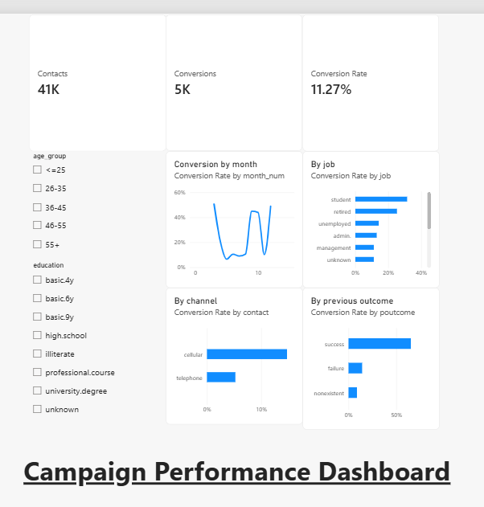
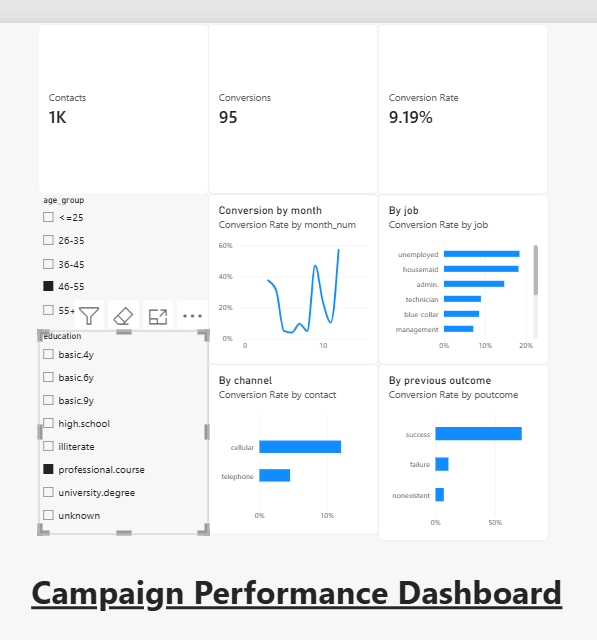

# Bank Campaign Performance Analysis

Analysis of 41,176 bank marketing contacts to find what drives conversion, built as a client-style campaign analytics project.

## Tools
Python (pandas), SQL (SQLite), Excel (pivots, COUNTIFS/SUMIFS, XLOOKUP), Power BI

## Data
UCI Bank Marketing dataset (bank-additional-full.csv). Conversion = customer said "yes" to the campaign offer.

## Steps
1. Clean data in Python (`clean.py`)
2. Calculate conversion KPIs by segment in SQL (`queries.sql`, `results.txt`)
3. Build Excel pivots and formulas (`campaign_summary.xlsx`)
4. Build an interactive Power BI dashboard (`dashboard.pbix`)
5. Write client-style insights (`insights.md`)

## Data cleaning
- Rows: 41,188 to 41,176 (12 duplicates removed)
- Nulls: 0
- "unknown" values kept as their own category: job 330, marital 80, education 1,730, default 8,596, housing 990, loan 990
- Created: converted (1 if y = yes), month_num, age_group

## KPIs
- Contacts = number of customers contacted
- Conversions = customers who said yes
- Conversion Rate = Conversions / Contacts (overall: 11.27%)

## Key findings
1. Cellular converts at 14.74% vs 5.23% for telephone (about 2.8x).
2. Previous success converts at 65.11% vs 8.83% for new contacts; previous failures convert at 14.23%.
3. May has the most contacts (13,767) but the lowest conversion (6.44%). Conversion falls from 13.04% on the first attempt to 4.61% at 7+ attempts.

## Recommendations
1. Shift outreach from telephone to cellular.
2. Prioritize past converters and re-engage past failures before cold contacts.
3. Cap follow-ups at about 3 attempts and move some May volume into high-converting months.

## Caveats
- Mar and Dec have small samples (546 and 182 contacts).
- This is bank data, not WhatsApp data. The method transfers; the numbers do not.

## Dashboard

## How to run
1. Put `bank-additional-full.csv` in `data/`
2. `pip install pandas`
3. `python clean.py`
4. Run the queries in `queries.sql` on `data/campaign.db`
5. Open `dashboard.pbix` in Power BI Desktop